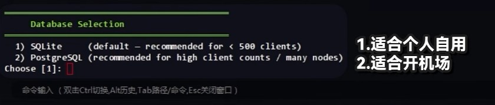
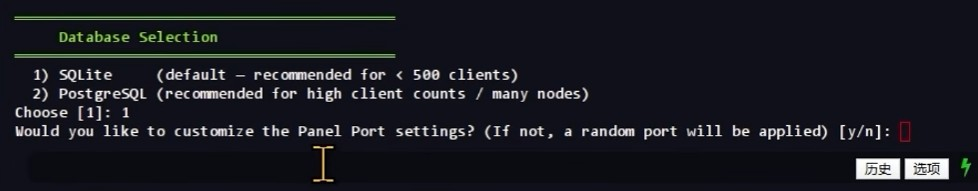
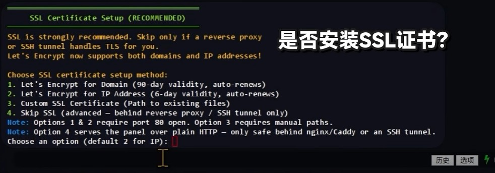
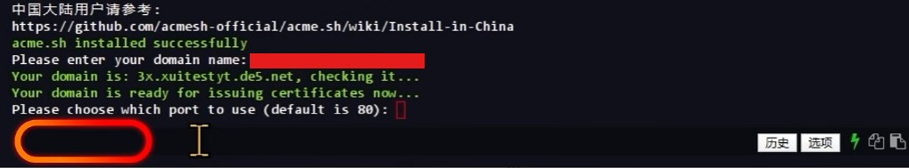
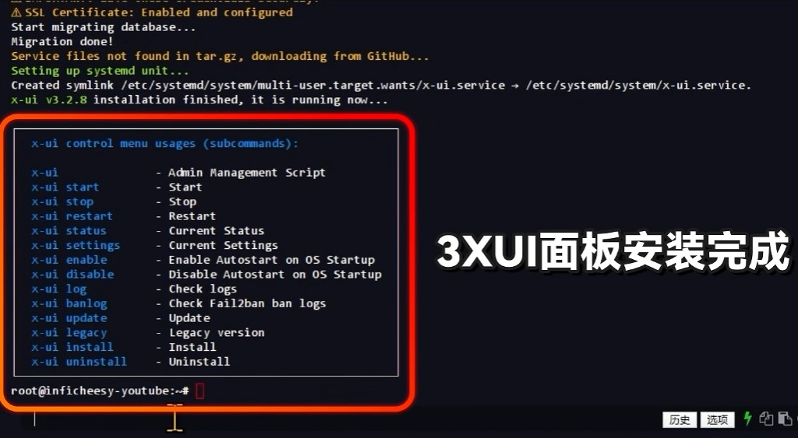
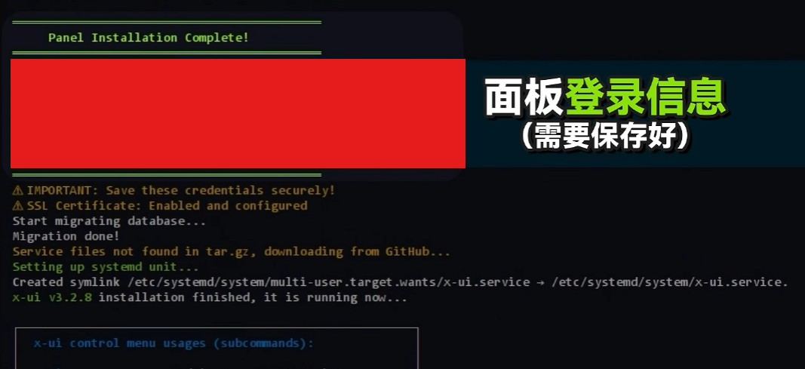
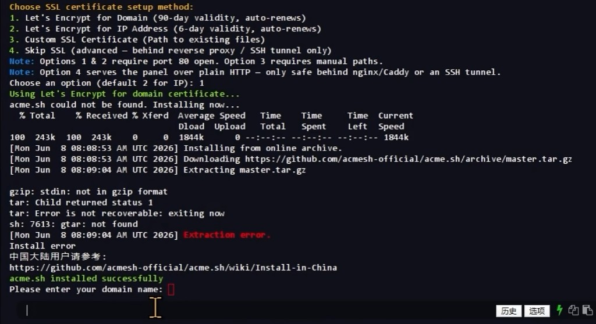

<div align="center">

# 3X-UI 个人版

### 从准备环境，到保存第一份登录信息

**v3.11.0 · Linux AMD64 · 非官方个人维护分支**

[下载个人版](https://github.com/nxabc/3x-ui/releases/tag/v3.11.0) · [查看源码](https://github.com/nxabc/3x-ui/tree/privacy-edition) · [备份与回滚](../PRIVACY.md)

</div>

> [!IMPORTANT]
> **全新安装与已有面板升级请分开操作。** 空白 Debian/Ubuntu AMD64 系统使用下方个人版安装脚本；已有面板的用户先备份，再按 [升级与回滚说明](../PRIVACY.md) 操作。全新安装脚本会拒绝覆盖已有安装。

## 开始之前

| 项目     | 本文示例                               |
| :------- | :------------------------------------- |
| 操作系统 | Debian 13；Ubuntu 请按实际系统验证     |
| CPU 架构 | `x86_64` / AMD64，使用 `uname -m` 查看 |
| 操作权限 | root 或 sudo                           |
| HTTPS    | 一个已解析到服务器的域名               |
| 测试环境 | 建议先在虚拟机中创建快照               |

## 01 · 更新系统

以下系统命令以 **root** 执行；普通用户先运行 `sudo -i`。在新装的测试系统中操作，已有业务的机器请先备份并安排维护时间。

```bash
apt update
apt upgrade -y
apt install -y curl ca-certificates
```

## 02 · 安装 3X-UI 个人版

**空白系统使用这条命令。** 面板和完整安装包都从 **nxabc/3x-ui** 下载，固定为 `v3.11.0`；不会安装官方最新版本。

```bash
bash <(curl -fsSL https://github.com/nxabc/3x-ui/releases/download/v3.11.0/install.sh) v3.11.0
```

> [!NOTE]
> 请先以 root 登录，或先运行 `sudo -i` 再执行上面的命令。执行安装时始终需要 root 权限。

### 推荐：下载并校验脚本后安装

```bash
mkdir -p ~/3x-ui-personal && cd ~/3x-ui-personal
curl -fLO https://github.com/nxabc/3x-ui/releases/download/v3.11.0/install.sh
curl -fLO https://github.com/nxabc/3x-ui/releases/download/v3.11.0/install.sh.sha256
sha256sum -c install.sh.sha256 && bash install.sh v3.11.0
```

安装程序会再次核对完整发布包的 SHA256。缺少校验文件或校验不一致时中止；系统与 CPU 架构不支持时也会退出。

### 已装官方 v3.11.0？使用升级包

从 [发布页](https://github.com/nxabc/3x-ui/releases/tag/v3.11.0) 下载 `privacy-panel-linux-amd64.tar.gz` 及其 `.sha256` 文件。按包内 `PRIVACY.md` 备份数据库、证书、配置和旧二进制，再替换面板及配套 CLI。**升级时不要执行全新安装脚本。**

## 03 · 选择数据库

基础安装程序出现数据库选项时，个人自用通常选择 **`1` → SQLite**。
如果有多节点或 PostgreSQL 的明确需求，再选择对应方案；不要对已有数据库随意切换类型。



_输入 `1` 并回车。截图为旧版操作示意，文案可能随版本变化。_

## 04 · 设置面板端口

出现自定义面板端口提示时，输入 **`Y`**，然后填写准备使用的端口。
例如 `12345`，仅作为演示；实际端口应未被其他服务占用。



_先选 `Y`，再根据后续提示填写端口。选择 `N` 则使用程序分配的随机端口。_

## 05 · 配置 HTTPS

### 选择域名证书

使用域名申请证书时，选择 **`1` → Let's Encrypt for Domain**。
先确认域名解析正确；若配置了 AAAA 记录，也要确认 IPv6 指向正确。



### 输入域名与验证端口

按提示输入自己的域名，例如 `panel.example.com`。
HTTP 验证端口使用 **`80`**，并确保公网 TCP 80 能到达验证服务。
域名、面板端口、证书验证端口是不同的配置项。



_这里的 `80` 用于证书验证，不会把前一步设置的面板端口改成 80。_

> [!WARNING]
> 看到 `Extraction error`、`Install error` 或证书申请失败时，先解决错误，不要仅凭后面的提示判断安装成功。未取得有效证书时，不要把明文 HTTP 面板直接暴露在公网。

## 06 · 检查安装结果

安装程序提示完成后，再检查实际服务状态：

```bash
x-ui status
systemctl status x-ui --no-pager
```



_截图显示旧版 `v3.2.8`，只用于说明完成提示和管理入口；本项目发布版本为 `v3.11.0`。_

## 07 · 保存登录信息

把以下信息保存到密码管理器，首次登录后确认 HTTPS 正常，并启用双因素认证。

| 需要保存       | 说明                           |
| :------------- | :----------------------------- |
| 完整面板地址   | 包含协议、域名、端口和访问路径 |
| 用户名与密码   | 以本次安装输出为准             |
| 双因素恢复信息 | 按实际配置安全保存             |



_不要把真实密码、完整访问路径或双因素密钥发到公开 Issue、截图或聊天群。_

## 端口放行 · 按实际环境检查

**不要按 VPS 商家名称判断是否存在防火墙。** 同时检查云平台安全组和系统内的 nftables、UFW 或 iptables 规则，保留 SSH 连接和回滚通道。

| 用途             | 需要检查的端口                          |
| :--------------- | :-------------------------------------- |
| SSH 管理         | 你实际使用的 SSH 端口                   |
| 面板登录         | 你选择的面板 TCP 端口                   |
| HTTP 证书验证    | TCP 80，按所选验证方式配置              |
| HTTPS / 反向代理 | 使用时检查 TCP 443                      |
| 节点服务         | 以入站协议实际使用的 TCP / UDP 端口为准 |

不要混用防火墙管理工具，也不要直接清空现有规则。先识别当前防火墙，再按对应工具添加规则并验证。

## 常见问题 · 证书工具下载失败

下面这张素材实际展示了 `acme.sh` 下载解压失败，并不是成功示例：



先检查服务器的 DNS、GitHub 连通性，以及下载文件是否确实为压缩包。确认工具安装成功后再继续申请证书；请保留报错日志并遮挡凭据后排查。

---

**个人版的更新约定：** 面板使用自己的 GitHub 发布渠道；Xray 核心继续使用原有独立更新入口。面板升级前始终备份数据库、证书、配置和旧二进制，具体步骤见 [备份与回滚](../PRIVACY.md)。
