<div align="center">

# 3X-UI 个人版安装指南

### 八步完成安装 · 从系统准备到保存登录信息

**v3.11.0 · Debian 13 示例 · Linux AMD64**

[下载个人版](https://github.com/nxabc/3x-ui/releases/tag/v3.11.0) · [项目源码](https://github.com/nxabc/3x-ui/tree/privacy-edition) · [备份与回滚](../PRIVACY.md)

</div>

> [!IMPORTANT]
> 本文用于**空白 Debian / Ubuntu AMD64 系统的全新安装**。已有面板请先备份并使用升级包，不要重复执行初装脚本。以下命令均以 **root** 执行；普通用户先运行 `sudo -i`。

## 开始前准备

| 项目       | 要求                                                    |
| :--------- | :------------------------------------------------------ |
| 系统       | Debian 13 示例；AMD64 / x86_64                          |
| 域名       | 自己可管理 DNS 的域名                                   |
| 证书验证   | 主流程使用 HTTP 验证，公网 TCP 80 需到达服务器          |
| SSH 与备份 | 保留当前 SSH 连接；空白虚拟机先创建快照，已有业务先备份 |

`panel.example.com` 是**脱敏示例域名，不能直接申请证书**，操作时替换成自己的域名。部分截图中的域名和敏感值经过编辑，不是可登录的地址或账号。

## 第一步 · 更新系统并安装 curl

### 1. 更新系统

```bash
apt update && apt upgrade -y
```

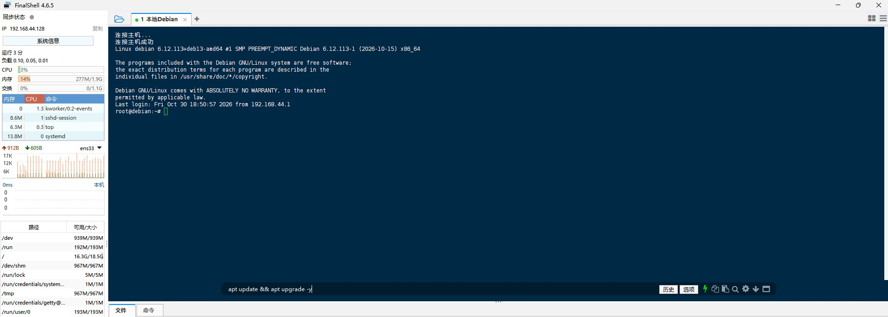

等当前命令完成、重新出现 `root@…:~#` 后再执行下一条。

### 2. 安装 curl

```bash
apt install -y curl ca-certificates
```

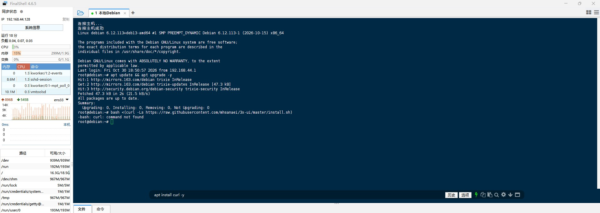

_截图中的 `curl: command not found` 用于识别缺少工具的情况；上方历史命令不是本教程的安装入口。先装好 curl，再执行第二步的个人版命令。_

## 第二步 · 安装 3X-UI 个人版

复制下面这一整行，在终端回车执行：

```bash
bash <(curl -fsSL https://github.com/nxabc/3x-ui/releases/download/v3.11.0/install.sh) v3.11.0
```

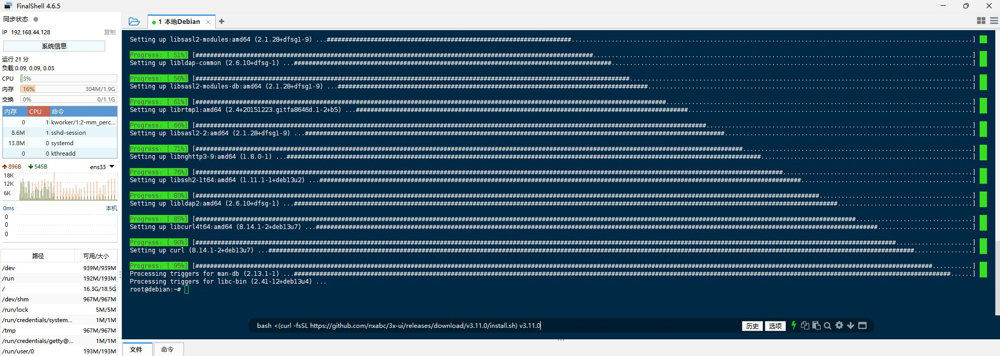

程序会下载完整安装包并核对 SHA256。保持网络稳定，耐心等待交互提示；不要反复启动安装或在下载中途切换代理模式。

<details>
<summary>先下载并校验安装脚本（可选）</summary>

逐条执行：

```bash
mkdir -p ~/3x-ui-personal && cd ~/3x-ui-personal
curl -fLO https://github.com/nxabc/3x-ui/releases/download/v3.11.0/install.sh
curl -fLO https://github.com/nxabc/3x-ui/releases/download/v3.11.0/install.sh.sha256
sha256sum -c install.sh.sha256 && bash install.sh v3.11.0
```

</details>

## 第三步 · 选择数据库

个人自用一般输入 **`1`** 并回车，选择 SQLite。需要 PostgreSQL 的用户按自己的部署方案选择；不要对已有数据库随意切换类型。

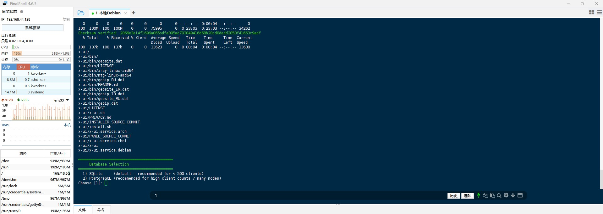

## 第四步 · 选择自定义端口

出现 `Would you like to customize the Panel Port settings?` 时输入 **`y`** 并回车。`y` 是自己设置端口，`n` 是使用程序分配的随机端口。

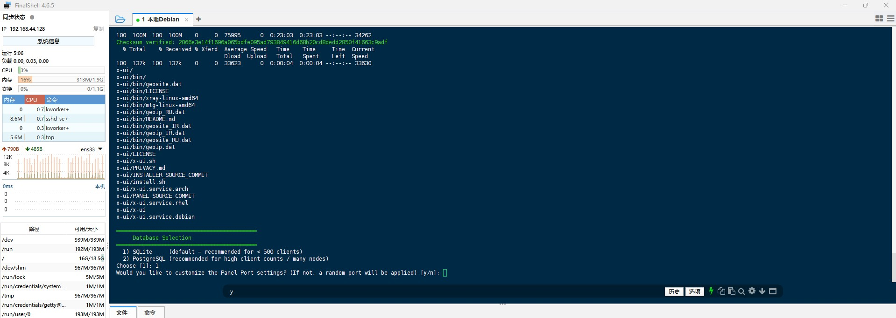

## 第五步 · 输入面板登录端口

填写未被占用的端口，例如 **`12345`**，然后回车。后续访问面板时要带上实际设置的端口。

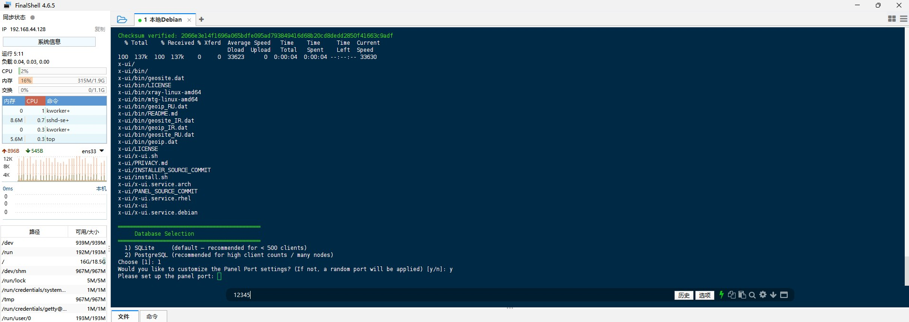

## 第六步 · 安装并绑定域名证书

### 1. 选择域名证书

输入 **`1`** 并回车，选择 `Let's Encrypt for Domain`。

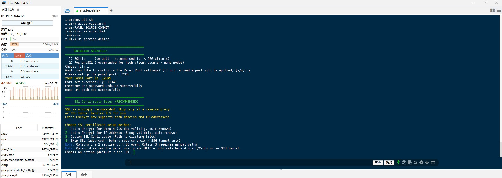

### 2. 输入自己的域名

等待 acme.sh 安装完成，在 `Please enter your domain name:` 后填写自己的域名。

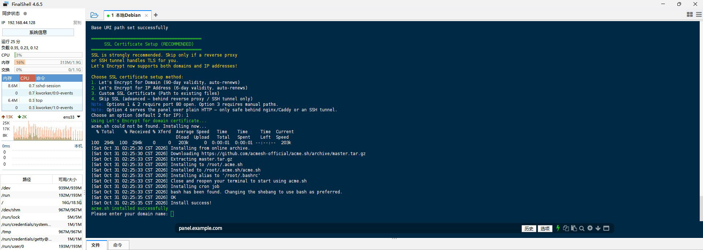

> [!NOTE]
> 新服务器使用本流程前，先将域名解析到服务器公网地址，确保 HTTP 验证可达；有 AAAA 记录时也要确认 IPv6 指向正确。只有局域网 IP 的虚拟机不能直接照搬公网 HTTP 验证，需要另外使用 DNS 验证或导入已有证书。

### 3. 填写证书验证端口

输入 **`80`** 并回车。这里是证书 HTTP 验证端口，不是第五步的面板端口。

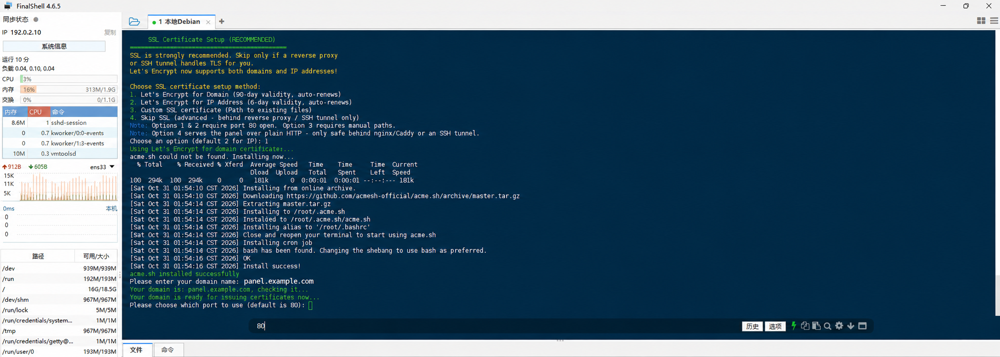

### 4. 保留默认重载命令

出现 `Would you like to modify --reloadcmd for ACME? (y/n):` 时，输入 **`n`** 并回车。

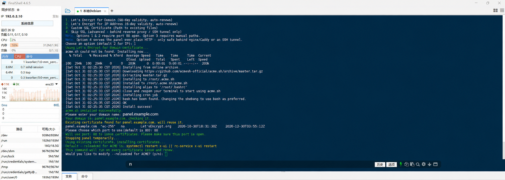

默认命令会在证书更新后尝试重启面板，使其加载新证书。**配置了重载命令，不代表所有验证方式都能自动续期**；手动 TXT 验证仍需人工处理。

### 5. 将证书绑定到面板

出现 `Would you like to set this certificate for the panel? (y/n):` 时，输入 **`y`** 并回车。

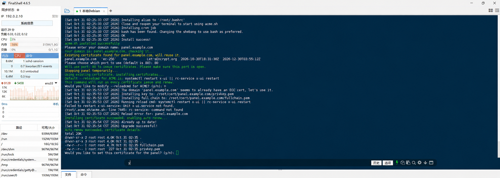

> [!NOTE]
> 截图来自本地演示，复用了提前申请的证书，所以会显示 `Existing certificate found`。首次安装尚未创建服务时，重载也可能显示 `Unit x-ui.service not found`。请检查第七步的最终服务状态；其他证书申请错误应先排查，不要忽略。

## 第七步 · 确认安装完成

出现以下提示，表示安装程序已执行到最后：

```text
x-ui v3.11.0 installation finished, it is running now...
```

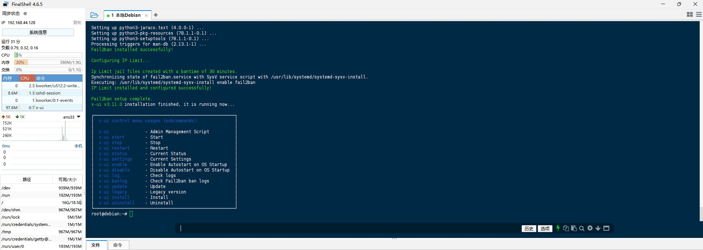

再单独执行以下命令，确认实际服务状态：

```bash
systemctl is-active x-ui
```

输出 **`active`** 表示服务正在运行。否则先查看日志：

```bash
journalctl -u x-ui -n 80 --no-pager
```

## 第八步 · 向上翻找并保存登录信息

向上滚动终端，找到 **`Panel Installation Complete!`** 区域，保存本次生成的配置信息。

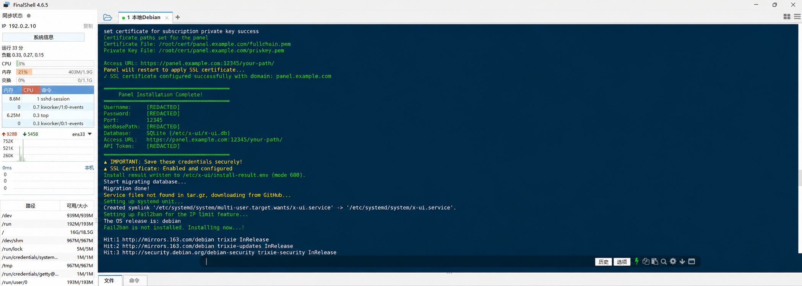

| 字段                | 保存内容                            |
| :------------------ | :---------------------------------- |
| Username / Password | 本次生成的用户名与密码              |
| Port                | 实际面板登录端口                    |
| WebBasePath         | 随机访问路径                        |
| Access URL          | 完整 HTTPS 地址，包含端口和访问路径 |
| API Token           | 访问凭据，按密码同等保护，不要公开  |

建议保存到密码管理器，按本次输出的完整 Access URL 登录。首次登录后检查 HTTPS 和账号安全设置，按需要启用双因素认证。截图中的 `[REDACTED]` 是脱敏占位，不能用于登录。

## 放行端口 · 按实际环境检查

不要根据 VPS 服务商名称跳过防火墙检查。云平台安全组和系统内的 nftables、UFW、iptables 都可能限制连接。

| 用途             | 需要检查                              |
| :--------------- | :------------------------------------ |
| SSH              | 实际 SSH TCP 端口，避免把自己锁在外面 |
| 证书验证         | 公网 TCP 80 到达验证服务              |
| 面板             | 本文示例 TCP 12345，按实际设置替换    |
| HTTPS / 反向代理 | 使用时检查 TCP 443                    |
| 节点             | 根据协议检查实际 TCP / UDP 端口       |

先识别当前防火墙，再使用对应工具添加规则。不要清空规则，也不要混用工具。`iptables-persistent` 仅适用于已明确采用该方案的机器，不是每台 Debian 都要安装。

---

**更新约定：** 面板使用个人版发布渠道，Xray 核心保留原有独立更新功能。面板更新前请备份数据库、证书、配置、旧二进制和配套 CLI，参见 [备份与回滚](../PRIVACY.md)。
